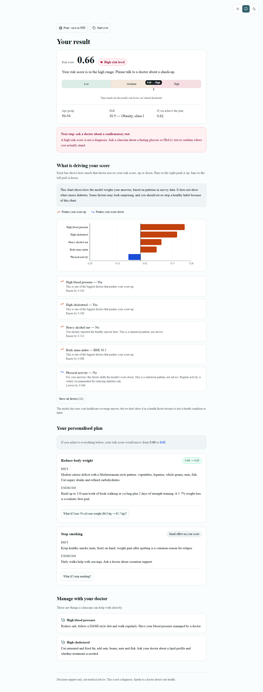
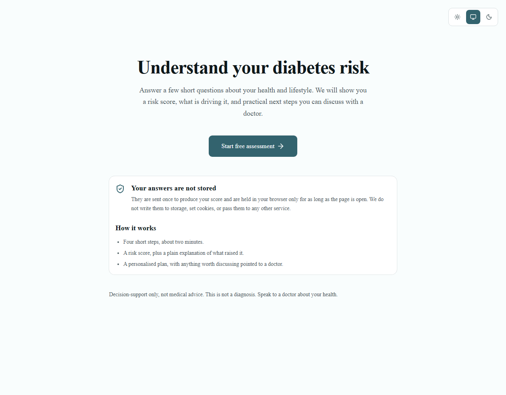
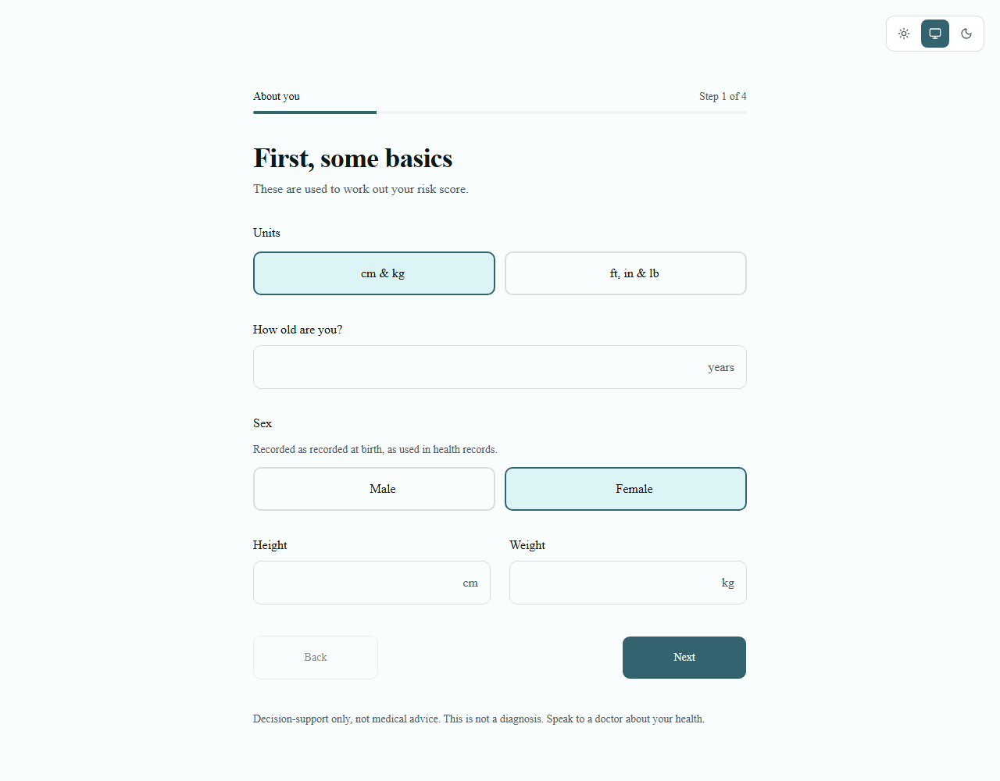
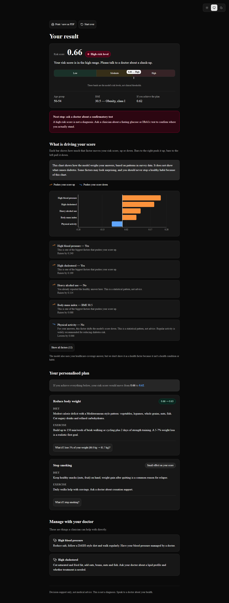

# DiaInsights

Understand your diabetes risk.

Answer a few short questions about your health and lifestyle. You get a **risk score**,
a plain-English explanation of what is driving it, and a personalised diet and exercise
plan to discuss with a doctor.

> **Decision-support only, not medical advice.** This is not a diagnosis. Speak to a
> doctor about your health.



## Features

- **Four-step assessment wizard** — age, sex, height and weight (metric or imperial,
  converted for you), health history, lifestyle, and healthcare coverage. Your answers
  are kept when you go back, and every field is checked against the same limits the
  model uses.
- **A risk score, not a probability** — with a plain sentence for where it lands and a
  gauge showing the model's own risk levels.
- **What is driving your score** — a diverging bar chart of SHAP contributions for all
  twelve health and lifestyle factors, each with a plain-English explanation. Blue means
  it pushes your score down, orange pushes it up, and both are also labelled with an
  icon and a word so colour is never the only signal.
- **A personalised plan** — one card per recommendation with diet and exercise guidance.
  Anything worth less than one percentage point is labelled a *small effect* rather than
  shown as "3% → 3%".
- **Interactive what-if** — ask "what if I stop smoking?" on any card and the model
  re-scores it live. If a change does not lower the score, we say so plainly and point
  out that its health benefits go beyond this score.
- **Manage with your doctor** — the items worth raising with a clinician.
- **Light and dark themes** following your system preference, with a visible toggle.
- **Print / save as PDF** — a clean print stylesheet for taking to an appointment.
- **Accessible by design** — keyboard operable throughout, screen-reader announcements,
  visible focus rings, a skip link, and WCAG AA contrast in both themes.

### What we deliberately don't do

- **Your answers are never stored.** No localStorage, no cookies, no analytics, no
  third parties. The assessment lives in memory only, so refreshing the page clears it.
  The single exception is your theme preference, stored under `theme`.
- **Healthcare coverage is hidden from the factor list.** The model does use it, but it
  isn't a health condition or a habit, so we don't present it as one either way.
- **We never call the score a probability or a diagnosis.**

## Screenshots

| | |
|---|---|
|  |  |
| **Landing page** | **Assessment wizard** |

Dark mode:



## Running it locally

Requires **Node.js 20+** and **Python 3.11+**. Two terminals.

### With Docker

```powershell
Copy-Item .env.example .env
docker compose up --build
```

Frontend <http://localhost:3000>, API <http://localhost:8000>. See [DEPLOY.md](DEPLOY.md)
for configuration, production deployment and HTTPS.

### Without Docker

Backend:

```powershell
cd backend
python -m venv venv
venv\Scripts\Activate.ps1
pip install -r requirements.txt
uvicorn api:app --reload --port 8000
```

Run everything from inside `backend/` — the model files are loaded through relative
paths, so starting uvicorn from the repository root fails.

### Frontend

```powershell
cd frontend
npm install
npm run dev
```

Open http://localhost:3000.

Copy `frontend/.env.example` to `frontend/.env.local` if the backend runs somewhere
other than `http://localhost:8000`.

The dev server is pinned to port 3000 because the backend's CORS allow-list defaults to
that origin.

## Running the tests

```powershell
# Backend: 61 unit/API tests
cd backend
venv\Scripts\python -m pytest -q

# Frontend: lint, colour contrast (both themes), backend parity, error handling
cd frontend
npm run check

# Backend parity for the what-if endpoint -- needs the backend running
npm run check:whatif

# End-to-end in a real browser. Stop your dev servers first.
npm run test:e2e
```

`npm run test:e2e` starts its own backend and frontend, so ports 8000 and 3000 must be
free. It runs 23 Playwright tests covering the full wizard, validation, tier handling,
keyboard operation, WCAG AA audits via axe at desktop and 375px, horizontal-scroll
checks, and it regenerates the screenshots above.

If Playwright reports a missing browser:

```powershell
npx playwright install chromium
```

## Repository layout

```
backend/     FastAPI + XGBoost + SHAP. Scoring maths and the trained model.
frontend/    Next.js (App Router) + TypeScript + Tailwind + shadcn/ui + Recharts.
e2e/         Playwright specs and committed screenshots.
```

See [AGENTS.md](AGENTS.md) for the constraints that govern changes to this repo, and
[backend/README.md](backend/README.md) for the API contract.